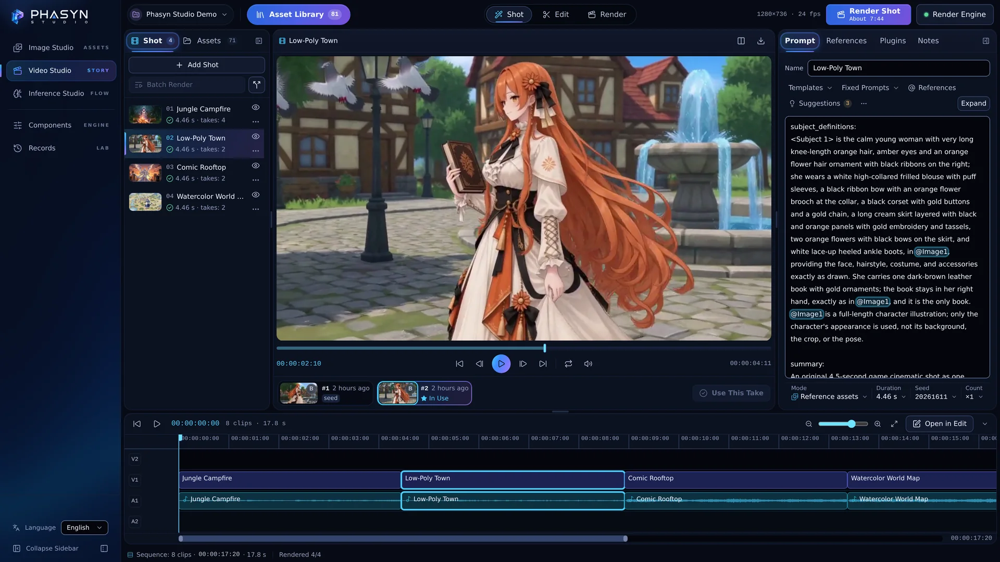
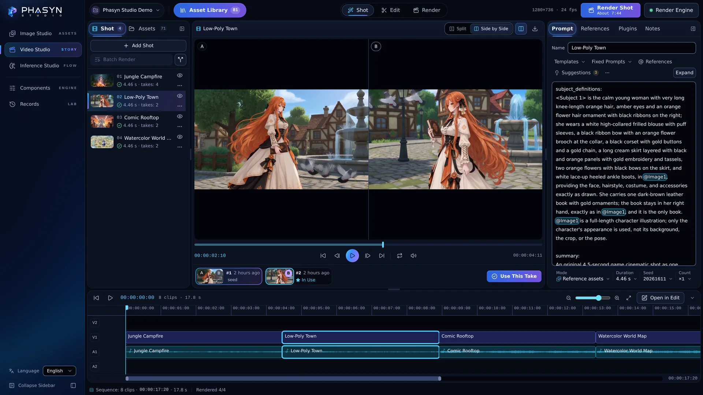
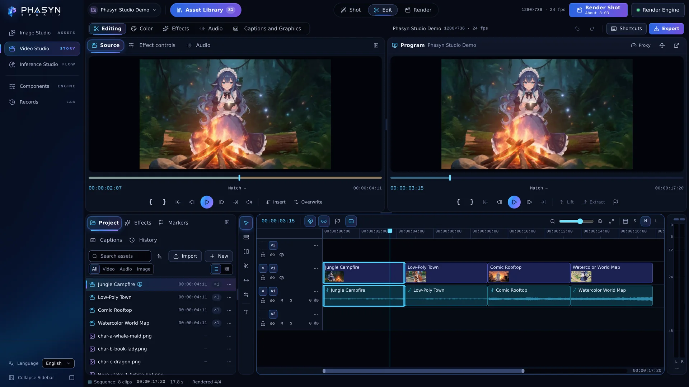
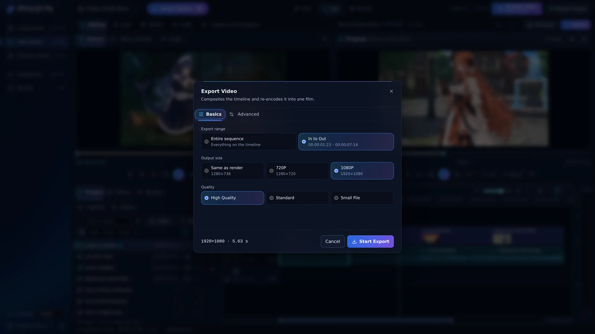
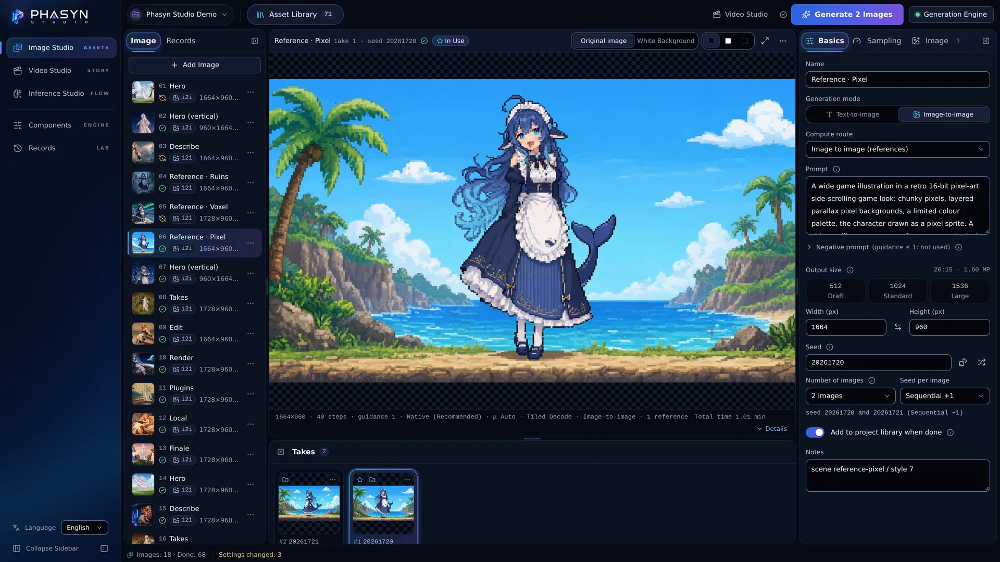

# Phasyn Studio

> **インストール方法がわからない？** 下の文をそのまま AI エージェント（Claude Code、Codex など）に渡せば、インストールしてくれます：
>
> ```text
> https://github.com/phasyn/phasyn-studio/blob/main/docs/agent-install.md に従って Phasyn Studio をインストールしてください。
> ```

自分のパソコンで、AI を使って音声付きの短い動画と画像を作れます。公式サイト：<https://phasyn.dev>

[English](README.md) | [繁體中文](README.zh-Hant.md) | **日本語**

<!-- INTRO FILM: a poster image linking to the film on https://phasyn.dev goes here once the film is published. -->

機能と画面は[公式サイト](https://phasyn.dev/ja/)をご覧ください。


*ショットワークスペース：ショットを書き、テイクを生成して、1 つ選びます。*


*同じショットの 2 つのテイクを並べて比較します。*


*編集ワークスペース：タイムラインにショットを並べ、トリミングし、音を付けます。*


*完成した作品を動画ファイルとして書き出します。*


*Image Studio：ショットに使う画像を作成・編集します。*

## できること

- ショットを文章で説明すると、音声付きの動画ができます。
- 自分の画像、動画クリップ、声を参考に使えます。
- 文章やほかの画像から画像を作れます。
- 動画編集ソフトのように、タイムラインでカットを並べて編集できます。
- トランジション、テキスト、字幕、音楽を加えて書き出せます。
- 完成したテイクを撮り直さずに改善できます：ディテールの修復、動きの補間、音の差し替え、ショットの延長。
- 動画モデルに複数の LoRA を重ね掛けでき、自分の動画からスタイル LoRA を学習できます。
- 画面は日本語、英語、繁体字中国語に対応しています。

## 自分の動画からスタイル LoRA を学習（実験的）

**推論 Studio → LoRA 学習** を開き、動画を追加して目指す方向（例：「アニメの戦闘カメラワークと打撃感」）を書きます。あとは Phasyn が自動で進めます。

1. 動画をクリップに切り分け、カットの切れ目、静止したショット、使えない映像を除きます。
2. 各クリップに自動でキャプションを付け、一部を評価用に残します。
3. 字幕、ロゴ、透かしをマスクして、LoRA がそれらを覚えないようにします。
4. H3 LoRA をチャンクごとに学習し、中断しても再開できます。
5. 同じプロンプトを複数の LoRA 強度でレンダリングして並べ、何が変わったかを比較できます。
6. 残す（ルートで選べる LoRA として登録）か破棄するかを選びます。

学習には H3 の重みと、メモリの大きい GPU Node（DGX Spark のような統合メモリのマシンなど）が必要です。使用する権利のある映像で学習してください。LoRA はコンポーネント設定で動画モデルに最大 4 つまで重ね掛けできます（高速化 LoRA は 1 つまで）。

## 必要なもの

- NVIDIA のグラフィックカードを積んだ Linux パソコン（ドライバーは CUDA 13.0 対応）。
- RTX 3060、RTX 5080、DGX Spark（GB10）で確認しています。ほかの RTX 30・40・50 シリーズも動くはずですが、まだ試していません。
- 十分なメモリとディスク容量（動画モデルは大きいです）。

## インストール

いちばん簡単な方法：インストーラーがこのコンピューターを調べて計画（どの機能をどのグラフィックカードで動かすか、
必要なモデルとライセンス）を表示し、同意するとすべてをインストールして起動します。

```sh
git clone https://github.com/phasyn/phasyn-studio.git
cd phasyn-studio
./install.sh --dry-run    # 計画を表示するだけ
./install.sh              # インストールして起動
```

計画とオプションの説明は [INSTALL.md](INSTALL.md)（英語）にあります。AI コーディングエージェントは
[docs/agent-install.md](docs/agent-install.md)（英語）に従ってください。

手動で行う場合：

```sh
git clone https://github.com/phasyn/phasyn-studio.git
cd phasyn-studio
uv sync --all-packages --frozen --extra gpu
pnpm install --frozen-lockfile && pnpm build
cp deploy/config/controller.example.json deploy/config/controller.json
cp deploy/config/node-a.example.json deploy/config/node-a.json
uv run phasyn-studio controller --config "$PWD/deploy/config/controller.json"
uv run phasyn-studio node --config "$PWD/deploy/config/node-a.json"   # 別のターミナルで
```

そのあと <http://127.0.0.1:8080> を開きます。最初の動画を作る前に、グラフィックカード用の環境の準備、モデルの
ダウンロード、コピーした 2 つのファイルの記入が必要です。手順はすべて [docs/install.md](docs/install.md)（英語）にあります。

## ライセンス

- Phasyn Studio は [Apache License 2.0](LICENSE) のオープンソースです。名前とロゴは対象外です（[NOTICE](NOTICE) を参照）。
- AI モデルは含まれていません。各モデルには独自のライセンスがあり、使える地域や用途が決まっています。MiniMax-H3 とそれで作った動画は
  EU、英国、韓国、米国では使うことも見せることもできず、Qwen-Image 2.1 は非商用に限られます。
- MiniMax-H3 で作った動画を、ほかの AI モデルの学習に使うことはできません。
- 権利のある画像、動画、声だけを使い、AI で作ったものを本物や他人になりすましたものとして扱わないでください。
  詳しくは [THIRD_PARTY_NOTICES.md](THIRD_PARTY_NOTICES.md) をご覧ください。
- デモのキャラクターはネットコミュニティのファンによるデザインで、原作者は ZipZipPipe と上善無形（溟月）です。権利は原作者に帰属し、本プロジェクトでは非商用のデモとしてのみ使用しています。
