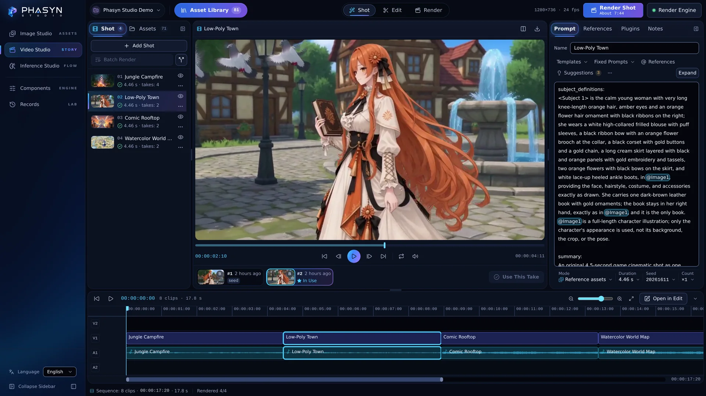
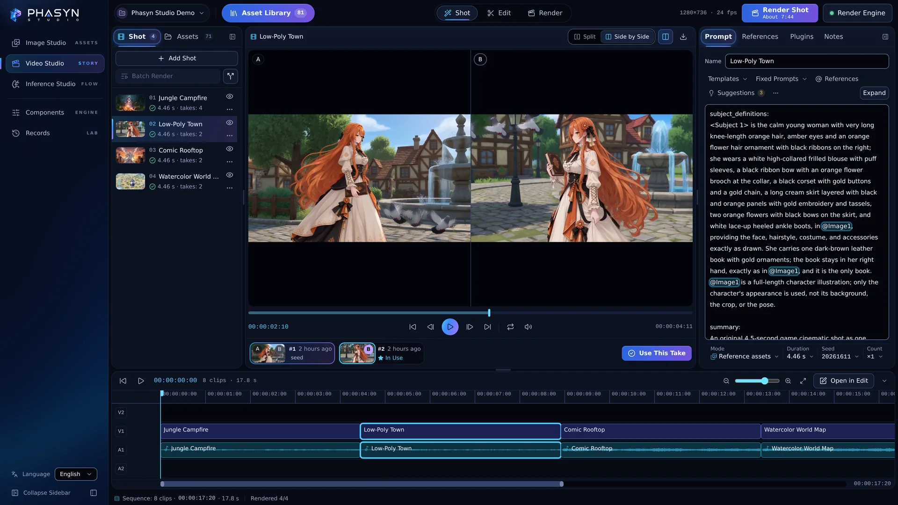
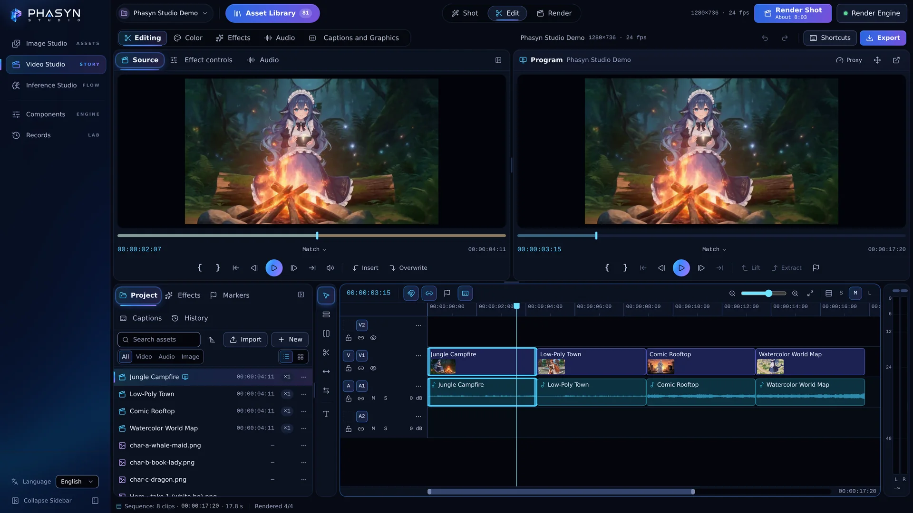
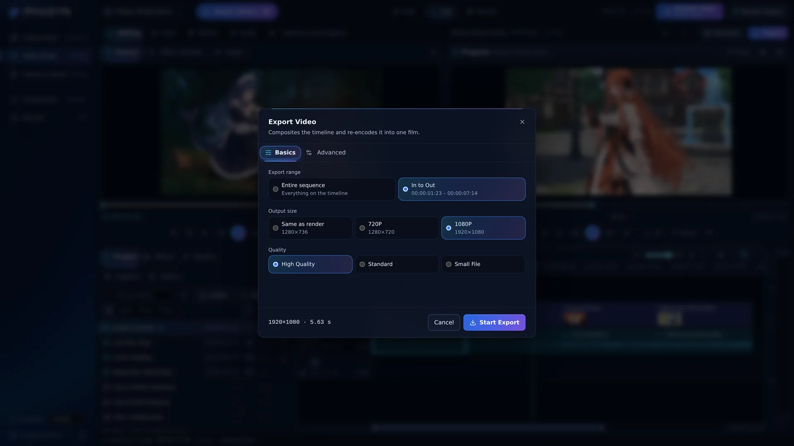
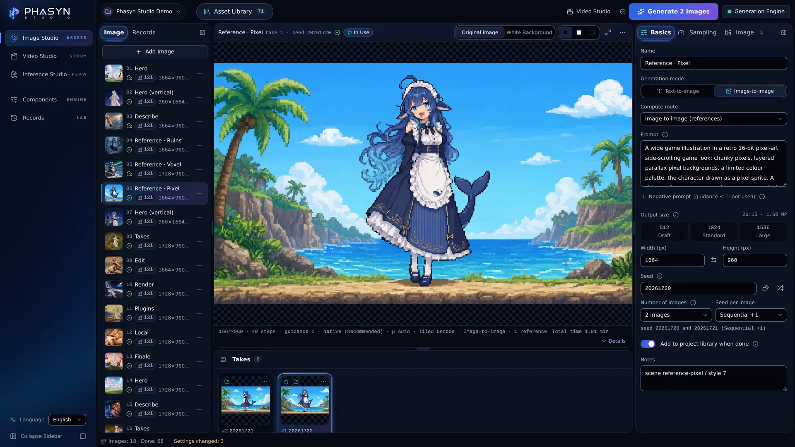

# Phasyn Studio

Make short videos with sound, and pictures, with AI on your own computer. Website: <https://phasyn.dev>

**English** | [繁體中文](README.zh-Hant.md) | [日本語](README.ja.md)

<!-- INTRO FILM: a poster image linking to the film on https://phasyn.dev goes here once the film is published. -->

See the [website](https://phasyn.dev/en/) for features and screenshots.


*Shot workspace: write the shot, render takes, pick one.*


*Compare two takes of the same shot side by side.*


*Edit workspace: arrange the shots on the timeline, trim and add sound.*


*Export the finished film as a video file.*


*Image Studio: make and edit pictures for your shots.*

## What it does

- Describe a shot in words and get a video with sound.
- Use your own pictures, clips and voices as references.
- Make pictures from text or from other pictures.
- Put the shots in order and cut the film on a timeline, as in a video editor.
- Add transitions, text, captions and music, then export the film.
- Works in English, Traditional Chinese and Japanese.

## What you need

- A Linux computer with an NVIDIA graphics card and a driver for CUDA 13.0.
- Tested on the RTX 3060, the RTX 5080 and the DGX Spark (GB10). Other RTX 30, 40 and 50 series cards should work but
  have not been tested.
- Plenty of memory and disk space: the video model is large.

## Install

The quickest way: the installer looks at your computer, shows a plan (which features run on which graphics card, and
which models and licenses are needed), and after you agree installs and starts everything.

```sh
git clone https://github.com/phasyn/phasyn-studio.git
cd phasyn-studio
./install.sh --dry-run    # only shows the plan
./install.sh              # installs and starts
```

[INSTALL.md](INSTALL.md) explains the plan and the options; AI coding agents follow
[docs/agent-install.md](docs/agent-install.md).

By hand:

```sh
git clone https://github.com/phasyn/phasyn-studio.git
cd phasyn-studio
uv sync --all-packages --frozen --extra gpu
pnpm install --frozen-lockfile && pnpm build
cp deploy/config/controller.example.json deploy/config/controller.json
cp deploy/config/node-a.example.json deploy/config/node-a.json
uv run phasyn-studio controller --config "$PWD/deploy/config/controller.json"
uv run phasyn-studio node --config "$PWD/deploy/config/node-a.json"   # in a second terminal
```

Then open <http://127.0.0.1:8080>. Before your first video you also set up the graphics card, download the models and
fill in the two copied files: [docs/install.md](docs/install.md) has every step.

## License

- Phasyn Studio is open source under the [Apache License 2.0](LICENSE). The names and logos are not; see [NOTICE](NOTICE).
- The AI models are not included. Each has its own license, and they limit where and how you may use them: MiniMax-H3
  and the videos it makes may not be used or shown in the EU, the UK, South Korea or the US, and Qwen-Image 2.1 is for non-commercial use only.
- Videos made with MiniMax-H3 may not be used to train other AI models.
- Only use pictures, clips and voices you have the rights to, and do not pass off AI-made content as real or as someone
  else. Details: [THIRD_PARTY_NOTICES.md](THIRD_PARTY_NOTICES.md).
- The demo characters are fan designs from the online community by ZipZipPipe and 上善無形 (溟月); all rights remain with the original creators, and they appear here only as a non-commercial demo.
