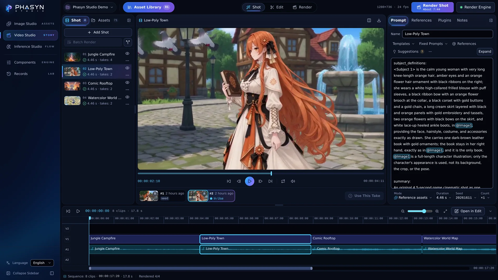
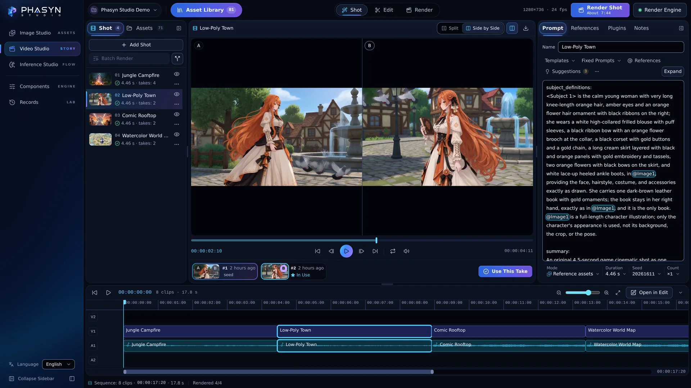
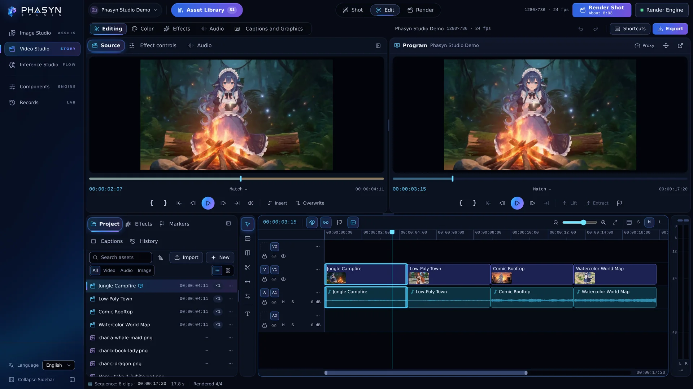
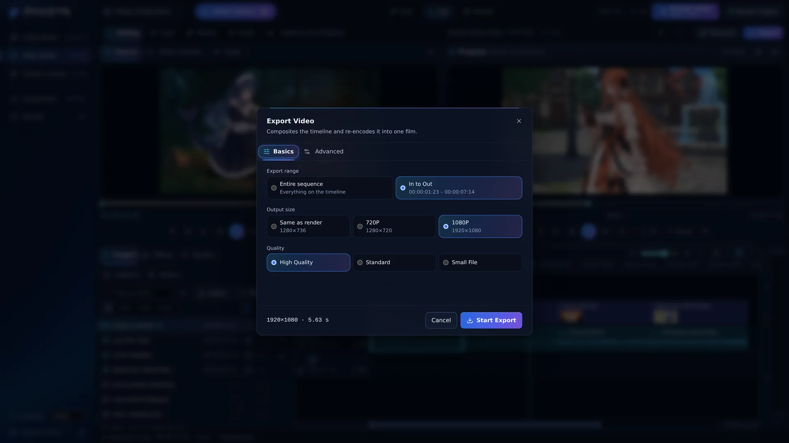
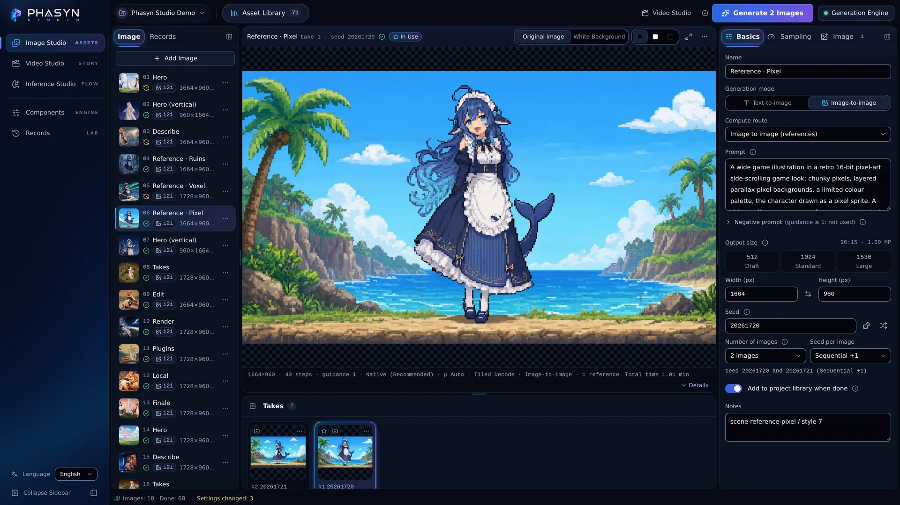

# Phasyn Studio

> **不知道怎麼安裝？** 直接把下面這段交給你的 AI agent（Claude Code、Codex 等），由它來安裝：
>
> ```text
> 請依照 https://github.com/phasyn/phasyn-studio/blob/main/docs/agent-install.md 幫我安裝 Phasyn Studio。
> ```

在自己的電腦上，用 AI 做有聲音的短片和圖片。官網：<https://phasyn.dev>

[English](README.md) | **繁體中文** | [日本語](README.ja.md)

<!-- INTRO FILM: a poster image linking to the film on https://phasyn.dev goes here once the film is published. -->

功能和畫面請看[官網](https://phasyn.dev/zh-hant/)。


*鏡頭工作區：寫鏡頭、生成幾個 take、挑一個。*


*把同一個鏡頭的兩個 take 並排比較。*


*剪輯工作區：在時間軸上排鏡頭、修剪、加聲音。*


*把完成的影片匯出成影片檔。*


*圖片工作室：為鏡頭製作和修改圖片。*

## 可以做什麼

- 用文字描述鏡頭，生成有聲音的影片。
- 用自己的圖片、影片片段和聲音當參考。
- 用文字或其他圖片生成圖片。
- 像剪輯軟體一樣，在時間軸上排鏡頭、剪片。
- 加轉場、文字、字幕和音樂，再匯出成片。
- 不用重拍就能改善完成的 take：修復細節、讓動作更順、換掉聲音或延長鏡頭。
- 在影片模型上串接多個 LoRA，也可以用自己的影片訓練風格 LoRA。
- 介面有繁體中文、英文和日文。

## 用自己的影片訓練風格 LoRA（實驗性）

打開 **推理 Studio → LoRA 訓練**，加入影片並寫下想要的方向（例如「動漫戰鬥的運鏡與打擊感」）。之後 Phasyn 會自動完成：

1. 把影片切成片段，跳過轉場、靜止鏡頭和不能用的畫面；
2. 自動為每個片段反推描述，並保留一部分片段做評估；
3. 遮掉字幕、標誌和浮水印，讓 LoRA 不會學到它們；
4. 分段訓練 H3 LoRA，中斷後可以接著訓練；
5. 用同樣的 Prompt 產生不同 LoRA 強度的結果並排比較，看出它改變了什麼；
6. 由你決定保留（會登錄成可以在路由中選用的 LoRA）或捨棄。

訓練需要 H3 權重，以及記憶體很大的 GPU Node（DGX Spark 這類統一記憶體的機器可以）。請只用你有權使用的素材訓練。要使用 LoRA，可以在元件設定中為影片模型串接最多四個 LoRA（加速 LoRA 最多一個）。

## 需要什麼

- 一台 Linux 電腦，有 NVIDIA 顯示卡，驅動程式支援 CUDA 13.0。
- 測試過 RTX 3060、RTX 5080 和 DGX Spark（GB10）。其他 RTX 30、40、50 系列應該可以用，但還沒測過。
- 足夠的記憶體和硬碟空間：影片模型很大。

## 安裝

最簡單的方式：安裝程式會先檢查這台電腦，列出計畫（哪些功能在哪張顯示卡上執行、需要哪些模型與授權），
你同意後就安裝並啟動全部服務。

```sh
git clone https://github.com/phasyn/phasyn-studio.git
cd phasyn-studio
./install.sh --dry-run    # 只列出計畫
./install.sh              # 安裝並啟動
```

計畫與選項的說明在 [INSTALL.md](INSTALL.md)（英文）；AI 程式代理請依照
[docs/agent-install.md](docs/agent-install.md)（英文）。

手動安裝：

```sh
git clone https://github.com/phasyn/phasyn-studio.git
cd phasyn-studio
uv sync --all-packages --frozen --extra gpu
pnpm install --frozen-lockfile && pnpm build
cp deploy/config/controller.example.json deploy/config/controller.json
cp deploy/config/node-a.example.json deploy/config/node-a.json
uv run phasyn-studio controller --config "$PWD/deploy/config/controller.json"
uv run phasyn-studio node --config "$PWD/deploy/config/node-a.json"   # 在第二個終端機
```

接著開啟 <http://127.0.0.1:8080>。做第一支影片之前，還要設定顯示卡的環境、下載模型，並填好剛才複製的兩個檔案：
每一步都寫在 [docs/install.md](docs/install.md)（英文）。

## 授權

- Phasyn Studio 以 [Apache License 2.0](LICENSE) 開源。名稱和標誌不在授權範圍內，見 [NOTICE](NOTICE)。
- 不包含 AI 模型。每個模型都有自己的授權，也限制了使用的地區和方式：MiniMax-H3 和它做出來的影片，不能在歐盟、英國、韓國和美國使用或展示，
  Qwen-Image 2.1 只能用於非商業用途。
- 用 MiniMax-H3 做出來的影片，不能拿去訓練其他 AI 模型。
- 只使用你有權利的圖片、影片和聲音，也不要把 AI 生成的內容當成真的或冒充別人。詳細內容見
  [THIRD_PARTY_NOTICES.md](THIRD_PARTY_NOTICES.md)。
- 示範角色的造型來自網路社群的同人創作，原作者為 ZipZipPipe 與上善無形（溟月），版權歸原作者所有，本專案僅作非商業示範。
